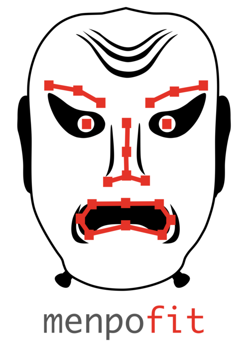

<p align="center">
  </center>
  <br><br>
  <a href="https://github.com/menpo/menpofit/blob/master/LICENSE.txt"></a>
  <a href="https://github.com/menpo/menpofit/actions/workflows/ci.yml"></a>
  <a href="https://pypi.org/project/menpofit/"></a>
</p>

menpofit - A deformable modelling toolkit
=========================================
The [Menpo Project](http://www.menpo.org/) package for state-of-the-art 2D deformable modelling techniques.
Currently, the techniques that have been implemented include:

### Affine Image Alignment
  - **Lucas-Kanade Image Alignment**
    - _Optimization algorithms:_ Forward Additive, Forward/Inverse Compositional
    - _Residuals:_ SSD, Fourier SSD, ECC, Gradient Correlation, Gradient Images

### Deformable Image Alignment
  - **Active Template Model**
    - _Model variants:_ Holistic, Patch-based, Masked, Linear, Linear Masked
    - _Optimization algorithm:_ Lucas-Kanade Gradient Descent (Forward/Inverse Compositional)

### Landmark Localization
  - **Active Appearance Model**
    - _Model variants:_ Holistic, Patch-based, Masked, Linear, Linear Masked
    - _Optimization algorithms:_ Lucas-Kanade Gradient Descent (Alternating, Modified Alternating, Project Out, Simultaneous, Wiberg), Casaded-Regression
  - **Active Pictorial Structures**
    - _Model variant:_ Generative
    - _Optimization algorithm:_ Weighted Gauss-Newton Optimisation with fixed Jacobian and Hessian
  - **Constrained Local Model**
    - Active Shape Models
    - Regularized Landmark Mean-Shift
  - **Unified Active Appearance Model and Constrained Local Model**
    - Alternating/Project Out Regularized Landmark Mean-Shift
  - **Ensemble of Regression Trees**
    - \[provided by [DLib](http://dlib.net/)\]
  - **Supervised Descent Method**
    - _Model variants:_ Non Parametric, Parametric Shape, Parametric Appearance, Fully Parametric

Installation
------------
MenpoFit requires Python 3.10 or newer and [Menpo](https://github.com/menpo/menpo) 0.12 or newer:

```
> pip install menpofit
```

or from conda-forge:

```
> conda install -c conda-forge menpofit
```

Optional extras: `pip install "menpofit[dlib]"` (the `menpofit.dlib` wrapper, needs [dlib](http://dlib.net/))
and `pip install "menpofit[fft]"` (faster FFTs with pyFFTW).

Documentation
-------------
See our documentation on [ReadTheDocs](http://menpofit.readthedocs.org)

Pretrained Models
-----------------
Any pretrained models are provided under the assumption that they are used only for **academic** purposes and may not be used for commercial applications. Please see the license of the [300W](https://ibug.doc.ic.ac.uk/resources/300-W/) project - upon which our pretrained models are trained.

Specifically, the pretrained models in `menpofit.aam.pretrained` may only be used for academic purposes.

Development
-----------
With [uv](https://docs.astral.sh/uv/) installed, `uv run pytest` sets up an environment and runs the unit and
smoke tests, and `uv run ruff check .` lints. The docs are built with Sphinx (`pip install -r docs/requirements.txt`,
then `sphinx-build docs/source docs/_build`).

Releasing
---------
Versions come from git tags (via `setuptools-scm`). To release, tag the commit on `master`
(`git tag -a v0.8.1 -m "menpofit 0.8.1" && git push origin v0.8.1`) and approve the `pypi` deployment on the
resulting [Release workflow](https://github.com/menpo/menpofit/actions/workflows/release.yml) run. Before anything is
published the workflow validates `.readthedocs.yaml` and builds the docs on the tagged commit (Read the Docs reads its
configuration from the tag, so a broken docs setup cannot be repaired afterwards); it then uploads the sdist and wheel
to PyPI with trusted publishing, creates a GitHub release (tags like `v0.8.1rc1` or `v0.8.1.dev1` are pre-releases), and
finally waits for Read the Docs to build `stable`. A manual run with `publish: testpypi` is a dry run. Do not put two
release tags on the same commit: the version is derived from the tag.
